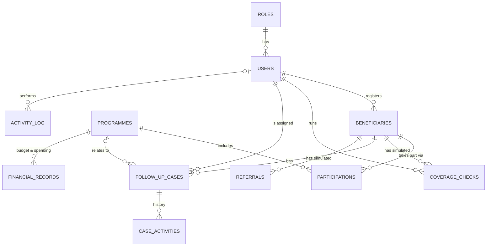

# Architecture and database design

## 1. Technology choice (recommended, not from the concept note)

| Part | Choice | Why |
|---|---|---|
| Web framework | **Flask 3** (Python) | Small and readable; each URL maps to one Python function |
| Pages | **Server-rendered HTML** with Jinja templates | No separate frontend build step; one program to start |
| Database | **SQLite** via Python's built-in `sqlite3` | A single file (`instance/demo.db`), nothing to install, easy to reset |
| Styling | One CSS file with shared design tokens | Same look on every page; no internet needed |
| Charts (from M4) | **Chart.js**, saved inside `app/static/vendor/` | Works offline; no CDN |
| Tests | Python's built-in `unittest` | Nothing extra to install |

**Why not Flask-SQLAlchemy / Flask-Login / React?** They are good tools, but they add dependencies and hide the SQL. For a demo built by a beginner, writing plain SQL with `?` placeholders keeps every step visible, stays secure, and means the only thing to install is Flask.

## 2. How the pieces fit

```
Browser ──HTTP──► run.py ──► create_app()  (app/__init__.py)
                                │
              before every request: check_csrf → load_logged_in_user  (app/security.py)
                                │
                    route function in a blueprint
                    ├── app/auth.py   /login  /logout
                    ├── app/main.py   /  /home  /settings  /settings/reset
                    └── (later) beneficiaries.py, coverage.py, cases.py, …
                                │
              @login_required / @permission_required  → 403 if not allowed
                                │
                    SQL through get_db()  (app/db.py)  ──► instance/demo.db
                                │
                    render_template("…html")  ──► app/templates/ + app/static/
```

### Planned coverage adapter (milestone 3)
```
coverage route ──► CoverageService (interface: check(beneficiary) -> result)
                        ├── SimulatedCoverageService   ← the only one built
                        └── (future) an approved SHA service — NOT built,
                            needs SHA approval, documentation and a security review
```
The route only talks to the interface, so a future approved integration could replace the simulation without rewriting the pages.

## 3. Entity-relationship diagram



Plain-text version (read "1 ─< many"):

```
roles 1 ─< users
users 1 ─< beneficiaries (created_by)
beneficiaries 1 ─< participations >─ 1 programmes      (many-to-many)
beneficiaries 1 ─< coverage_checks        (simulated only)
beneficiaries 1 ─< follow_up_cases 1 ─< case_activities
programmes    1 ─< follow_up_cases (optional)
beneficiaries 1 ─< referrals              (simulated only)
programmes    1 ─< financial_records
users         1 ─< activity_log
```

## 4. The tables, in plain English

| Table | What one row is | Key links | Notes |
|---|---|---|---|
| `roles` | One proposed role, e.g. Administrator | — | What each role may do is in `app/permissions.py` |
| `users` | One fictional staff account | `role_id` → roles | Password stored only as a hash |
| `programmes` | One fictional Sports Fund programme | — | Status: Planned / Active / Completed |
| `beneficiaries` | One fictional person in the registry | `created_by` → users | No medical fields, no ID number; phone stored masked |
| `participations` | "This person is in this programme" | → beneficiaries, → programmes | Lets one person join several programmes without copying data |
| `coverage_checks` | One **simulated** coverage check | → beneficiaries, → users | `is_simulated` must be 1; the database refuses anything else |
| `follow_up_cases` | One enrolment-support or follow-up case | → beneficiaries, programmes, users | Has a priority, due date and status |
| `case_activities` | One event in a case's history | → follow_up_cases | Created, assigned, status change, note |
| `referrals` | One **simulated** guidance/referral record | → beneficiaries | Fictional facilities; nothing is sent anywhere |
| `financial_records` | One fictional allocation or expenditure | → programmes | `linked_activity` empty = not linked to a documented activity |
| `activity_log` | One recorded action | → users | Prototype log, not a production audit trail |

**Not stored on purpose:** current coverage status. It is worked out from the latest row in `coverage_checks`, so the same fact is never kept in two places and can't disagree with itself.

## 5. Sample data

`app/seed.py` creates the fictional data with a fixed random seed (2026), so every reset gives the same records. Dates are relative to the reset day, so the data always looks current. Current volume: 160 beneficiaries, 8 programmes, ~140 simulated checks, ~40 cases with history, 30 referrals, ~110 financial entries, 10 demo accounts.
